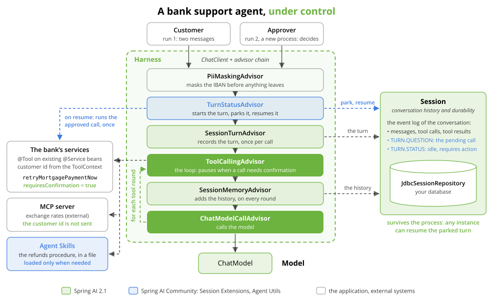
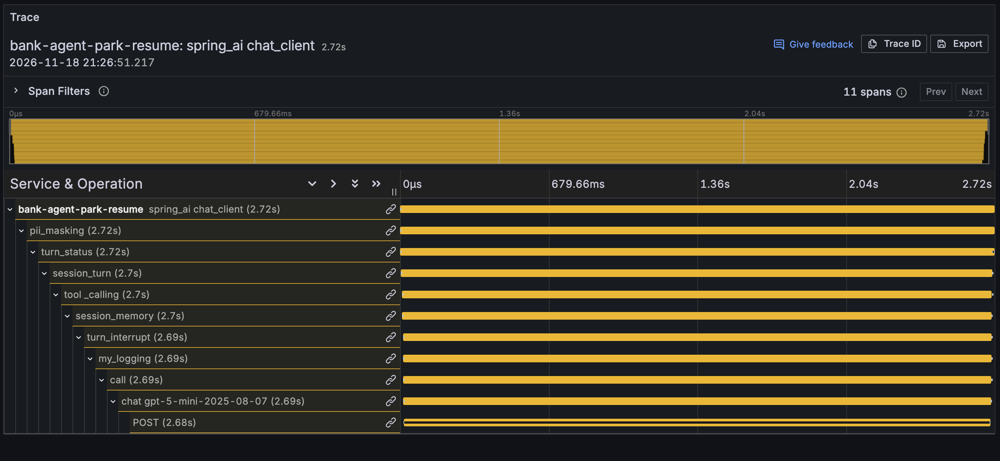
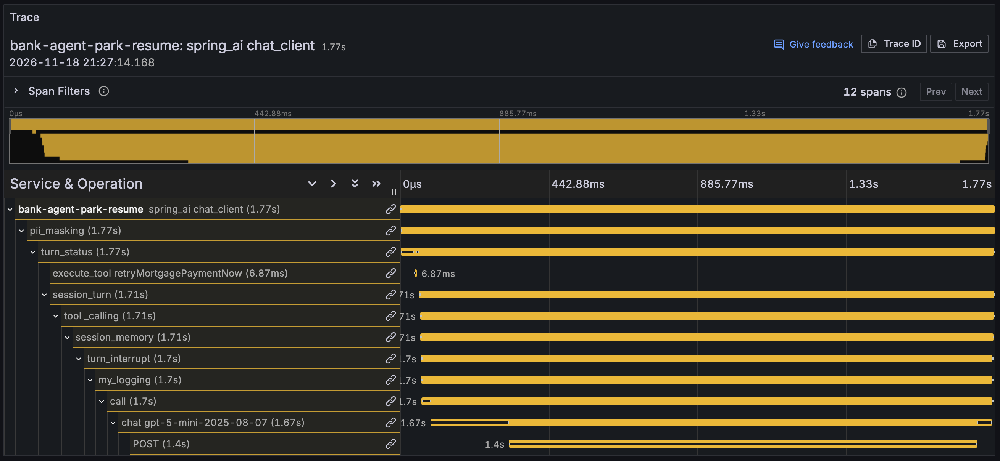

# 25 - Bank agent: confirm, park and resume

A bank support agent that answers from the bank's own systems, keeps account numbers inside the bank, and
does not move money on its own. The customer asks to collect a failed mortgage payment today. The model asks for
the tool that does it, the tool loop pauses, and the turn is **parked** in the session log. The process exits.
A second process finds the parked turn in the database, asks a person, and **resumes** the turn. With the
`full` profile the conversation then goes on with a question that needs a skill and one that needs an MCP
server.

| What | Where it comes from |
|---|---|
| `@Tool` on existing `@Service` beans, the customer id in the `ToolContext` | Spring AI |
| `PiiMaskingAdvisor`: the IBAN never reaches the model, the session log or the traces | an advisor of this demo |
| `@Tool(requiresConfirmation = true)`: the tool loop pauses, no tool runs | Spring AI 2.1, tool call confirmation |
| The conversation in a database (`AI_SESSION`, `AI_SESSION_EVENT`) | Spring AI 2.1, session memory with the JDBC session repository |
| `spring.ai.tools.limits.*`: a cap on the tool calls of the loop | Spring AI 2.1, tool call limits |
| The turn status, park and resume (`TurnAdvisors`, `TurnService`) | [Spring AI Session Extensions](https://github.com/spring-ai-community/spring-ai-session-extensions), community |
| The `refunds` skill: a procedure in a file, loaded by the model only when a question needs it (`full` profile) | [Spring AI Agent Utils](https://github.com/spring-ai-community/spring-ai-agent-utils) `SkillsTool`, community |
| Exchange rates from an MCP server, next to the bank's own tools (`full` profile) | Spring AI, the MCP client starter (stdio; not the 2026-07-28 protocol) |



The harness is the `ChatClient` and its advisor chain. The session is the event log of the conversation, kept in
the database by the JDBC session repository, so a second process can resume the turn the first one parked.

## Prerequisites

- Java 17+, Maven
- `OPENAI_API_KEY` or `ANTHROPIC_API_KEY`, from the repo-root `.env` or the environment. `spring.ai.model.chat`
  in `application.properties` picks the model: `openai` (the default here) or `anthropic`.
- Only for the `full` profile: Node.js with `npx`, for the MCP server. `mcp-servers-config.json` starts
  `@cyanheads/exchange-rates-mcp-server` (ECB reference rates). It needs the network, and the first start
  downloads the package.

All dependencies are released versions from Maven Central: Spring AI 2.1.0, Spring AI Session Extensions 0.11.0
and Spring AI Agent Utils 0.14.0.

## Run

From the repo root, after one `mvn install -DskipTests -pl common`:

```bash
# Run 1: the conversation, until the turn parks. The process exits.
mvn -q spring-boot:run -pl 25-bank-agent-park-resume

# Run 2: another process. It finds the parked turn, asks for the approval on the console,
# resumes the turn and goes on with one more question.
mvn -q spring-boot:run -pl 25-bank-agent-park-resume
```

Run 1 takes about 20 seconds and three model calls, run 2 about 15 seconds and three model calls.
After run 2 the session is idle, so the next run is a run 1 again: it resets the bank's data, deletes the
session and starts a new conversation. A parked turn is cleared only by a run 2.

Run 2 has three ways to go:

| At the prompt, or on the command line | What happens |
|---|---|
| `y` | The tool runs, once, and the model finishes the turn. |
| Enter, `n`, or a sentence | The tool does not run. The sentence is the reason, and the model reads it as the result of the call. Without one the reason is "The approver declined the collection." |
| `--demo.new-message='...'` | The customer writes something new instead of waiting. There is no prompt: the turn advisor denies the open call, and the new text goes to the model. |

```bash
# Run 2, the customer moves on
mvn -q spring-boot:run -pl 25-bank-agent-park-resume \
  "-Dspring-boot.run.arguments=--demo.new-message='Never mind, I will wait for the planned retry. What is my balance?'"
```

### The full tour (`full` profile)

```bash
mvn -q spring-boot:run -pl 25-bank-agent-park-resume -Dspring-boot.run.profiles=full
```

Use it for both runs. It starts the MCP server, and run 2 goes on with two more questions: one that needs the
`refunds` skill and one that needs the exchange rates. Run 2 then takes about 35 seconds and seven model calls.

## What to expect

The orange blocks come from `MyLoggingAdvisor`: `USER` is what goes to the model, `ASSISTANT` is what comes
back. Every `USER` block has a `TOOLS` line with the tools the model may call. The listings below leave out the
Spring Boot log lines, repeat the `TOOLS` line once and shorten the answers.

Run 1:

```
[PII] masked before the model: My mortgage payment from [IBAN] did not go out this month, what happened?

USER:
 - TOOLS: ["accountBalance","mortgagePaymentStatus","upcomingMortgagePayments","retryMortgagePaymentNow","Skill"]
 - TEXT: My mortgage payment from [IBAN] did not go out this month, what happened?

ASSISTANT:
 - TOOL-CALL: mortgagePaymentStatus ({"month":"2026-11"})

USER:
 - TOOL-RESPONSE: mortgagePaymentStatus: "2026-11-01: CHF 1450.00, FAILED (Direct debit rejected: balance was 312.40 on the due date)\n2026-11-28: CHF 1450.00, RETRY_PLANNED (Automatic retry of the November payment)"

ASSISTANT:
 - TEXT: Anna, the mortgage payment of CHF 1450.00 due 2026-11-01 failed because the direct debit was rejected ...

USER:
 - TEXT: I have the money now. Please collect it today.

ASSISTANT:
 - TOOL-CALL: retryMortgagePaymentNow ({"month":"2026-11"})

The turn in the session log:
  TURN.STATUS    RUNNING
  MESSAGE        USER I have the money now. Please collect it today.
  MESSAGE        ASSISTANT calls retryMortgagePaymentNow {"month":"2026-11"}
  TURN.QUESTION  toolConfirmation
  TURN.STATUS    IDLE / REQUIRES_ACTION   <- parked

The pause is in the session log, not in this process. Run the demo again to decide.
```

The last block is read back from the database. The `MESSAGE` events are what Spring AI session memory stored.
The `TURN.*` events are what Session Extensions wrote next to them.

Run 2, approved:

```
The account balance is CHF 2180.55. The parked turn waits on:
  retryMortgagePaymentNow {"month":"2026-11"}   <- needs a decision

Approve? [y/N, or a reason to decline]: y

USER:
 - TOOL-RESPONSE: retryMortgagePaymentNow: "Collected CHF 1450.00 for 2026-11 on 2026-11-19. The new account balance is CHF 730.55."

ASSISTANT:
 - TEXT: Anna, I collected CHF 1450.00 for the November 2026 mortgage payment today (2026-11-19). The new account balance is CHF 730.55.

The turn in the session log:
  TURN.STATUS    RUNNING
  MESSAGE        USER I have the money now. Please collect it today.
  MESSAGE        ASSISTANT calls retryMortgagePaymentNow {"month":"2026-11"}
  TURN.QUESTION  toolConfirmation
  TURN.STATUS    IDLE / REQUIRES_ACTION   <- parked
  TURN.ANSWER    [{key=call_oz0AUOXw1tztiBpSSbEmNJ23, allowed=true}]
  TURN.STATUS    RUNNING
  MESSAGE        TOOL retryMortgagePaymentNow: "Collected CHF 1450.00 for 2026-11 on 2026-11-19. The new account balance is CHF ...
  MESSAGE        ASSISTANT Anna, I collected CHF 1450.00 for the November 2026 mortgage payment today (2026-11-19). The new acc ...
  TURN.STATUS    IDLE / END_TURN

USER:
 - TEXT: And next month?

ASSISTANT:
 - TOOL-CALL: mortgagePaymentStatus ({"month":"2026-12"})

USER:
 - TOOL-RESPONSE: mortgagePaymentStatus: "2026-12-01: CHF 1450.00, SCHEDULED"

ASSISTANT:
 - TEXT: Anna, the December mortgage payment is scheduled for 2026-12-01 for CHF 1450.00 ...
```

The first five events of the log are the ones run 1 wrote. The other five are from this process.

Run 2, declined with a reason:

```
Approve? [y/N, or a reason to decline]: The customer has an open dispute on this account.

USER:
 - TOOL-RESPONSE: retryMortgagePaymentNow: The customer has an open dispute on this account.
```

The log then has `TURN.ANSWER [{key=call_..., allowed=false, message=The customer has an open dispute on this
account.}]`, and the model tells the customer why the payment was not collected.

Run 2 with `--demo.new-message`:

```
USER:
 - TEXT: Never mind, I will wait for the planned retry. What is my balance?

ASSISTANT:
 - TOOL-CALL: accountBalance ({})

USER:
 - TOOL-RESPONSE: accountBalance: "CHF 2180.55"

The turn in the session log:
  ...
  TURN.STATUS    IDLE / REQUIRES_ACTION   <- parked
  TURN.ANSWER    [{key=call_hntgQS7Mzts2mphwaw5LMnvZ, allowed=false, message=The tool call was not run: the user moved on witho ...
  TURN.STATUS    RUNNING
  MESSAGE        TOOL retryMortgagePaymentNow: The tool call was not run: the user moved on without deciding on it.
  MESSAGE        USER Never mind, I will wait for the planned retry. What is my balance?
  MESSAGE        ASSISTANT calls accountBalance {}
  MESSAGE        TOOL accountBalance: "CHF 2180.55"
  MESSAGE        ASSISTANT Anna, your current account balance is CHF 2180.55 ...
  TURN.STATUS    IDLE / END_TURN
```

Run 2 on the `full` profile, after the question about next month. The `TOOLS` line now also lists the `fx_*`
tools of the MCP server:

```
USER:
 - TEXT: I was charged twice for the same CHF 620 purchase. When do I get my money back?

ASSISTANT:
 - TOOL-CALL: Skill ({"command":"refunds"})

USER:
 - TOOL-RESPONSE: Skill: "Base directory for this skill: .../skills/refunds\n\n# Refund Handling\n\n## Policy ...

ASSISTANT:
 - TEXT: Anna, because the duplicate charge is CHF 620 (over CHF 500) it requires manual review by the fraud team and that review may take up to 10 business days ...

USER:
 - TEXT: How much is one payment in euros, at the latest rate?

ASSISTANT:
 - TOOL-CALL: fx_convert_currency ({"base_currency":"CHF","quote_currency":"EUR","amount":1450.00})

USER:
 - TOOL-RESPONSE: fx_convert_currency: [{"text":"**1450 CHF** = **1578.47 EUR**\nRate: 1.0886 (EUR/CHF) · 2026-11-23\n*ECB reference (mid-market) · ECB via Frankfurter*"}]

ASSISTANT:
 - TEXT: Anna, one mortgage payment of CHF 1450 at the latest rate equals EUR 1,578.47 ...
```

| Step | What it shows |
|---|---|
| Turn 1 | The `[PII]` line: the IBAN never leaves. The model worked out `2026-11` from "this month" and the date in the prompt. The reason and the retry date come from the row, not from the model. |
| Turn 2 | The model asks for `retryMortgagePaymentNow`, and nothing happens: there is no `TOOL-RESPONSE`. The log ends on the question and the parked status, and the process exits. |
| Run 2 | A new JVM. It knows the session id and nothing else. The pending call, with its arguments, comes from the session log. The balance is still CHF 2180.55: nothing ran while the turn was parked. |
| Resume | The call carries the decision and no user message. The tool runs once, with the customer id from the tool context, and the model finishes the turn it started in the other process. |
| "And next month?" | No subject. The session log makes it the mortgage, across the two processes. |
| "I was charged twice for the same CHF 620 purchase" (`full`) | The `TOOLS` line has one `Skill` tool. The model calls `Skill({"command":"refunds"})` and only then reads the policy in `skills/refunds/SKILL.md`. The answer applies its rule for amounts above CHF 500: a review by the fraud team, up to 10 business days. |
| "How much is one payment in euros?" (`full`) | The bank's services cannot answer this. The `TOOLS` line lists the `fx_*` tools of the MCP server next to the bank's own, and the model calls `fx_convert_currency`. |

Stable across runs: the masking, the parked turn and the events in the log. The wording of the answers varies
with the model, and so does the tool it picks for "And next month?" (`mortgagePaymentStatus` or
`upcomingMortgagePayments`). The exchange rate varies with the day.

## How it works

```java
ChatClient agent = chatClientBuilder
    .defaultTools(accounts, mortgages)                                           // the bank's services
    .defaultTools(mcpToolCallbackProvider.getIfAvailable(...))                   // an MCP server ('full' profile)
    .defaultTools(SkillsTool.builder().addSkillsResources(skillsDirs).build())   // the skills (community)
    .defaultToolContext(Map.of(CustomerIdentity.TOOL_CONTEXT_KEY, customer))     // who the customer is
    .defaultAdvisors(new PiiMaskingAdvisor())                                    // before anything leaves
    .defaultAdvisors(TurnAdvisors.builder(sessionService)                        // session memory + park and resume
        .toolCallingManager(toolCallingManager)
        .build())
    .build();
```

The tool that moves money, in `MortgageService`:

```java
@Tool(description = "Collects the planned retry of a failed mortgage payment today ...", requiresConfirmation = true)
public String retryMortgagePaymentNow(String month, ToolContext toolContext) { ... }
```

The advisor chain of one call, outermost first:

| Order | Advisor | Does |
|---|---|---|
| HIGHEST + 50 | `PiiMaskingAdvisor` | replaces IBANs and 9+ digit numbers in the user message, once per call |
| HIGHEST + 100 | `TurnStatusAdvisor` (extensions) | starts the turn, ends it, parks it on a paused reply, resumes it from decisions |
| HIGHEST + 200 | `SessionTurnAdvisor` (Spring AI) | keeps the turn in the session log consistent |
| HIGHEST + 300 | `ToolCallingAdvisor` (Spring AI) | the tool loop; pauses when a call needs a confirmation |
| HIGHEST + 1000 | `SessionMemoryAdvisor` (Spring AI) | loads the history and stores every round, inside the loop |
| 0 | `MyLoggingAdvisor` | the orange lines |

Run 1 ends on a paused reply:

```java
ChatResponse response = agent.prompt().user(message).advisors(SessionAdvisors.session(sessionId)).call().chatResponse();
ToolCallDecisions.awaitingDecision(response);        // not empty: the turn is parked
```

Run 2 reads the question from the log and answers it:

```java
TurnService turns = new TurnService(sessionService);
turns.status(sessionId).isParked();                                              // true
ToolConfirmationQuestion question = ToolConfirmationQuestion.from(turns.pendingQuestion(sessionId));

agent.prompt()
    .advisors(TurnStatusAdvisor.decisions(sessionId, new ToolCallDecisions(decisions)))   // allow or deny, per call
    .advisors(TurnStatusAdvisor.runId(turns.status(sessionId).runId()))                   // optional: keep the run id
    .call()
    .content();
```

The run id is optional. With it the resumed half of the turn runs under the run id of the parked turn. Without
it the resume runs under a new one.

The log blocks of the listings come from `sessionService.getEvents(sessionId)`.

## The skill

The `Skill` tool is always there. The question that needs it is asked on the `full` profile.

`SkillsTool` from Spring AI Agent Utils reads the skills under `agent.skills.dirs` (`classpath:/skills`) and
gives the model one tool, `Skill`. Its description lists each skill's front matter, the name and the
description, and not the body of the file. The model calls `Skill({"command":"refunds"})` when a question needs it, and only then gets the text of
`skills/refunds/SKILL.md`. The policy in that file is made up for the demo.

## The MCP server (`full` profile)

On the `full` profile (`application-full.properties`) the MCP client starter reads `mcp-servers-config.json`, starts the exchange-rate server with `npx` and exposes its
tools as a `ToolCallbackProvider`, which the agent gets with `.defaultTools(...)`. Two beans keep it in check:

- `ToolContextToMcpMetaConverter.noOp()`: by default the MCP client sends the tool context to the server as the
  metadata of each tool call. Here the tool context holds the customer's identity, so nothing is sent.
- `McpToolFilter`: hides the server's `fx_dataframe_*` tools, which a support agent does not need.

This is the stdio transport of the earlier protocol, not the stateless 2026-07-28 revision. The application
closes its context and stops the server process when the conversation is over.

## The database

One H2 file holds the bank's tables and the session log, at `${java.io.tmpdir}/spring-ai-bank-agent-demo/bank`.
The bank's rows are reset when a new conversation starts (`bank-data.sql`), and not while a turn is parked, so
the second process sees what the first one left. The session tables are created by the JDBC session
repository. In production the session store is the application's PostgreSQL, MySQL, MariaDB or SQL Server.

The date is pinned with `demo.today=2026-11-19`, and `bank-data.sql` fits it, so "this month" stays November 2026
whenever the demo runs.

## The audit trail (`otel` profile)

The Micrometer observations Spring AI emits, exported to the Grafana stack of
[`24-observability/docker`](../24-observability/docker):

```bash
cd 24-observability/docker && docker compose up -d && cd ../..
mvn -q spring-boot:run -pl 25-bank-agent-park-resume -Dspring-boot.run.profiles=otel
```

Add the full tour with `-Dspring-boot.run.profiles=full,otel`.

On this profile the app is a web app on port 8080, so Prometheus can scrape it. It exits when the conversation
is over, like the plain run; the traces are in Grafana (<http://localhost:3000>, no login). The content
switches in `application-otel.properties` say which spans may carry what: the model span records the masked
prompt, the tool span the arguments and the result.

The two halves of the parked turn, as traces in Tempo. Run 1: the model asks for the tool, and the trace has
no `execute_tool` span, because the turn parked.



Run 2, another process: `turn_status` runs `execute_tool retryMortgagePaymentNow` from the approver's decision,
then the model finishes the turn.


